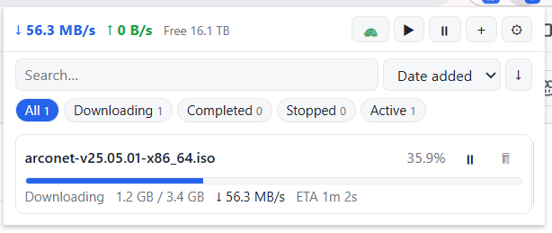
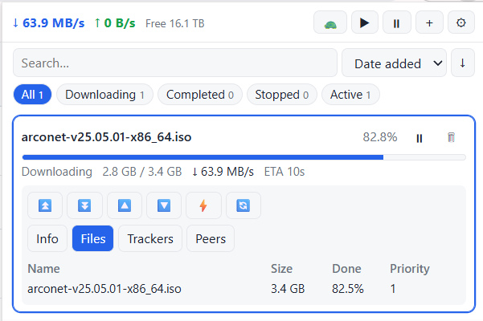
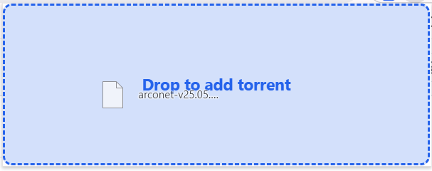

# qBittorrent Monitor

A small Chrome extension to watch and control your **qBittorrent** server from the toolbar: what is downloading,
speeds, progress, stop / start, add torrents, and more, without opening the WebUI.

Built for qBittorrent **5.x** (WebUI API v2). No build step, no dependencies: plain JavaScript.

| Torrent list | Torrent details | Drag & drop |
|---|---|---|
|  |  |  |

## Features

- Live list of all torrents: progress bar, percentage, state, size, speeds, ETA, ratio; refreshes every 2 s (configurable)
- Stop / start per torrent or all at once, delete (with or without files, with confirmation), alternative speed limits (turtle mode)
- Click a torrent to expand it: Info, Files, Trackers, Peers; priority (top / bottom / up / down), force start, recheck
- Filters with counters (All / Downloading / Completed / Stopped / Active), search, sort by date, name, speed, progress or size
- Add torrents: `＋` button (magnet, URL or `.torrent`, with category / save path / add stopped), drag & drop onto the popup,
  right-click any link → **Send to qBittorrent**, and (optional) plain clicks on `magnet:` / `.torrent` links
- Badge on the icon with the total number of torrents (blue while something downloads, grey otherwise);
  the tooltip shows `downloading / total`
- Notification when a download finishes
- Light / dark theme follows the system
- Interface in **English** and **Romanian** (switchable in Settings)
- Talks only to **your** server: no analytics, nothing sent anywhere else

## Install (no Web Store needed)

1. Download `qbittorrent-monitor-vX.Y.zip` from [Releases](../../releases) (or clone this repo), unzip it and put the
   folder somewhere permanent.
2. Open `chrome://extensions` and turn on **Developer mode**.
3. **Load unpacked** → select the folder that contains `manifest.json`.
4. Pin the extension from the puzzle-piece menu.
5. Open its **Settings** (⚙ in the popup): enter the WebUI address (e.g. `https://host:8080`), username and password,
   press **Save & test**. Chrome asks for permission to reach that host: accept.

Works in any Chromium browser (Chrome, Edge, Brave…). The qBittorrent **Web UI** must be enabled and reachable from
your browser; if it is exposed to the internet, use HTTPS with a valid certificate.

**Updating:** replace the files in the same folder and press ↻ (Reload) on the extension card; settings are kept.
**Note:** removing the extension also deletes its settings.

## How it works

The popup, the background service worker and the settings page call the WebUI API (`/api/v2/...`) directly with `fetch`;
there is no server component. The list uses the incremental `sync/maindata` endpoint, so it stays light.

qBittorrent's CSRF protection rejects requests whose `Origin` is `chrome-extension://…`. The extension sets `Origin` /
`Referer` to the server's own address for API calls to the host you configured (a `declarativeNetRequest` rule), so you
don't have to turn off any WebUI setting.

When you send a `.torrent` link, the extension downloads the file itself (with the page's session, so login-only links
work) and uploads it to qBittorrent. If that is not possible it falls back to sending the URL, which qBittorrent must
then fetch on its own.

## Permissions

| Permission | Why |
|---|---|
| `storage` | keep your settings (server address, user, password, language) |
| `alarms` | refresh the badge and detect finished downloads every 30 s while the popup is closed |
| `notifications` | "download complete" and "added" notifications |
| `contextMenus` | "Send to qBittorrent" on links |
| `declarativeNetRequest` | the Origin / Referer fix above, limited to your server's API URL |
| host access (optional, asked at runtime) | only for the server address you enter in Settings |
| content script on all pages | intercept `magnet:` / `.torrent` link clicks and download `.torrent` files in the page's own session; can be switched off in Settings |

## Privacy

The address, username and password of your server are stored in `chrome.storage.local` on your machine,
**unencrypted** (like any extension setting). Use a dedicated qBittorrent account if that matters to you.
Nothing is sent anywhere except to your qBittorrent server.

## Limitations

- With the popup closed, the badge and notifications update every 30 s (the minimum Chrome allows for alarms).
- A cross-origin `.torrent` link that cannot be fetched from the page is sent to the server as a URL; if the server
  cannot fetch it either, it fails silently on the server side.
- qBittorrent 5.x only: older versions use `pause` / `resume` instead of `stop` / `start`.

## Version history

- **1.0** – first version

## License

MIT
© 2026 Fallen
